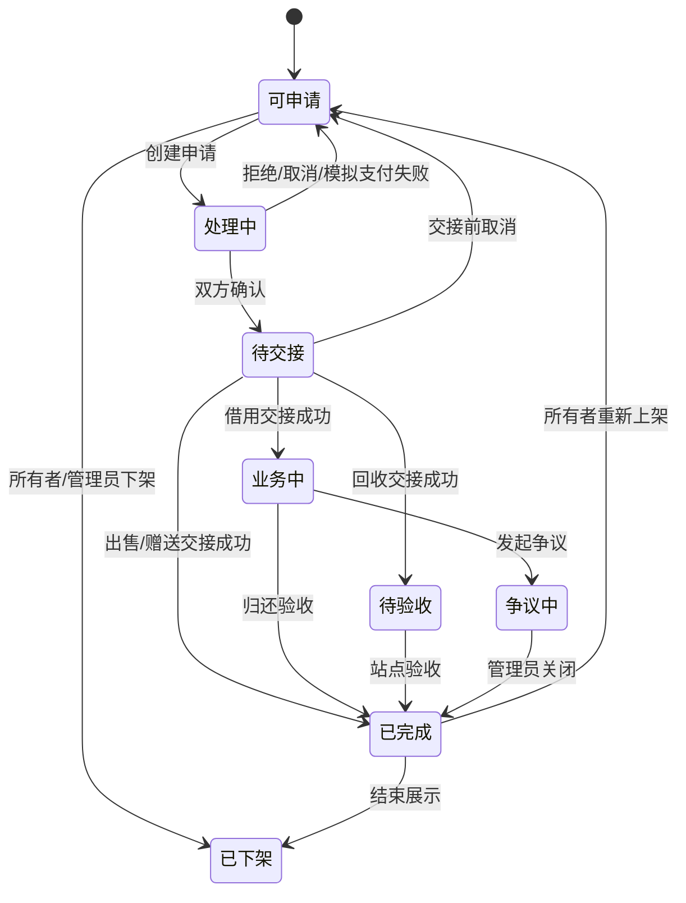
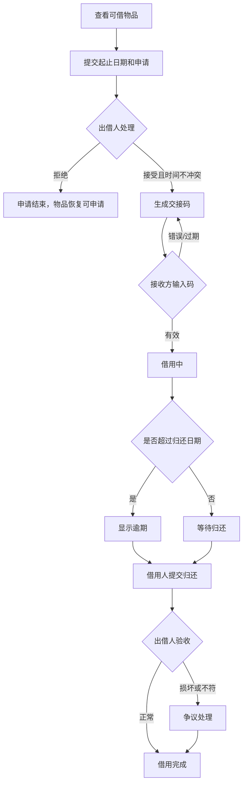
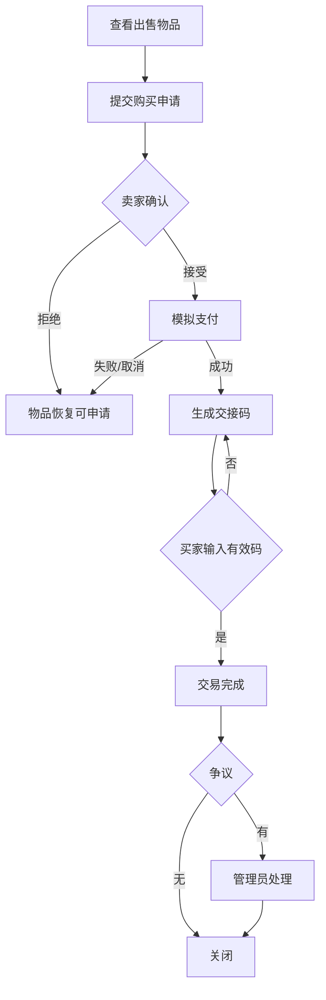
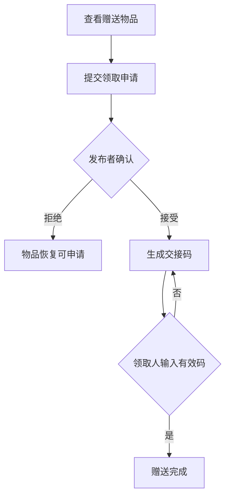
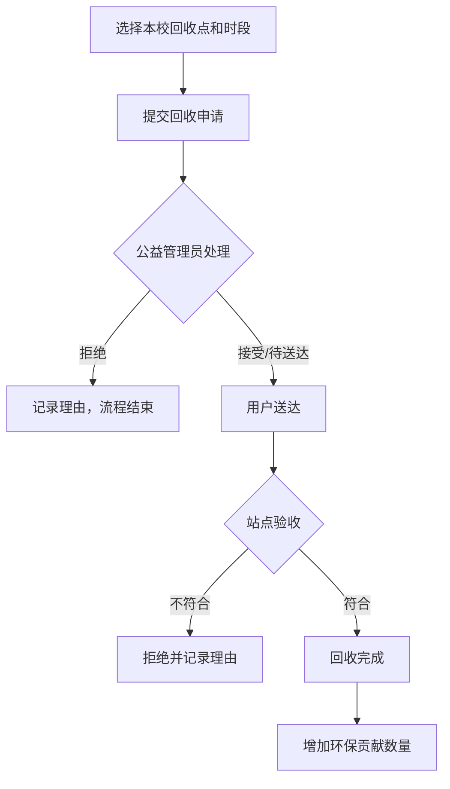
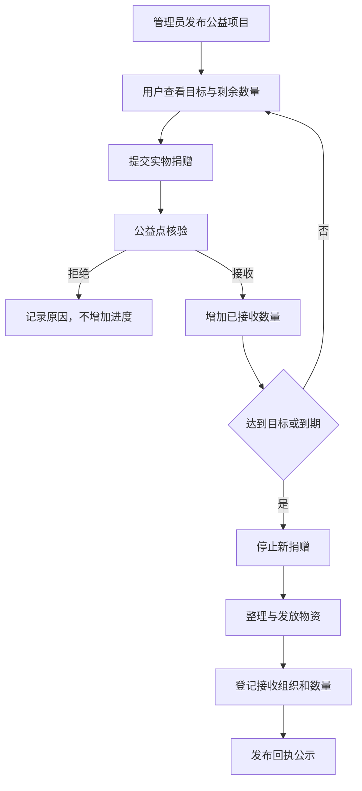
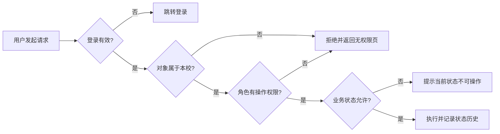

# 青禾流转 6.1 业务流程图

| 项目 | 内容 |
|---|---|
| 版本 | 1.0 |
| 状态 | 已批准并冻结 |
| AI 名称 | Codex |

## 1. 物品流转总原则

同一物品同一时间只能存在一个“处理中/待交接/流转中/争议中”的业务。

## 2. 共享借还

交接前可由申请方或出借人在允许条件下取消；交接完成后只能走归还或争议。

## 3. 二手交易

模拟支付只记录状态，不对应真实账户或资金流。

## 4. 免费赠送

同一物品只能有一个有效领取申请。

## 5. 绿色回收

公益管理员只能处理分配给本校和自己站点的申请。

## 6. 公益实物捐赠

确认数量不得超过目标数量；回执不包含受助儿童的可识别个人信息。

## 7. 跨校与越权阻断

