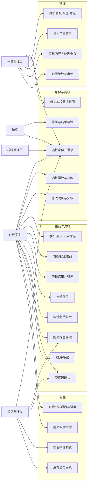

# 青禾流转 6.1 用例图

| 项目 | 内容 |
|---|---|
| 版本 | 1.0 |
| 状态 | 已批准并冻结 |
## 1. 总体用例图

## 2. 角色边界

- 在校学生中的物品所有者、借用者、买家、领取者和捐赠者共用同一个账号角色。
- 公益管理员的业务范围限定在被分配的学校和站点。
- 平台管理员管理所有学校，但所有写操作都记录高校范围和操作者。
- 校级管理员可登录并进入本校管理范围，只能操作所属高校的组织、账号、名单、审核、争议和审计。
- 跨学校用例不允许存在；同校跨校区用例允许。

## 3. 主要用例关系

| 角色 | 用例 | 前置条件 | 结果 |
|---|---|---|---|
| 在校学生 | 注册 | 名单已导入且学号手机号匹配 | 创建本校学生账号 |
| 在校学生 | 申请借用 | 物品可借用且无进行中业务 | 生成借用申请 |
| 出借用户 | 接受借用 | 申请待处理且借期不冲突 | 生成交接阶段 |
| 接收方 | 确认交接 | 交接码有效且属于约定业务 | 进入借用中或成交 |
| 在校学生 | 发起争议 | 存在已完成或进行中的相关业务 | 管理员可处理 |
| 公益管理员 | 核验捐赠 | 捐赠属于本校本站点 | 更新公益进度或拒绝 |
| 平台管理员 | 导入名单 | CSV 格式合法 | 学生可注册，导入过程可追踪 |

## 4. 关键包含关系

- “借用/购买/领取/回收”都包含“权限与高校范围校验”。
- “交接”包含“一次性交接码校验”。
- “公益进度更新”包含“站点核验”。
- “管理员审核和争议处理”包含“状态历史与审计记录”。

