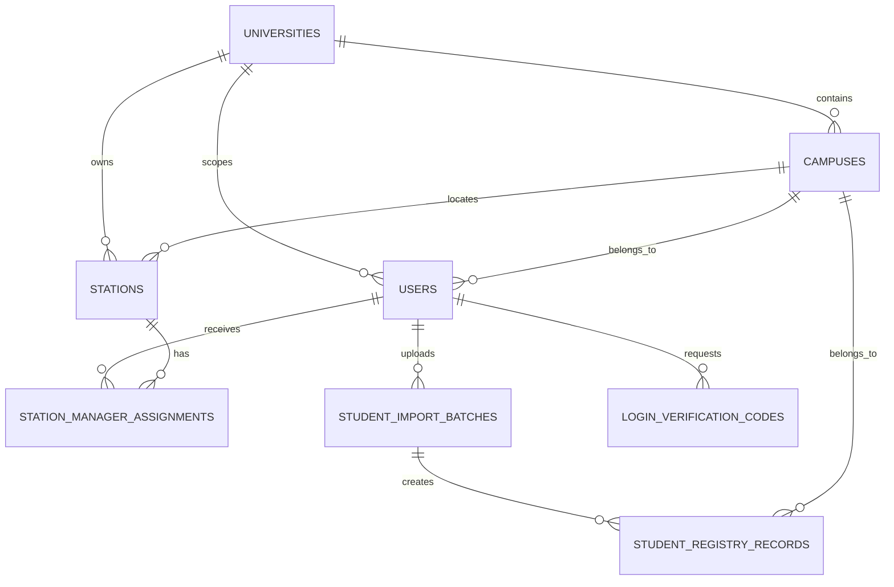
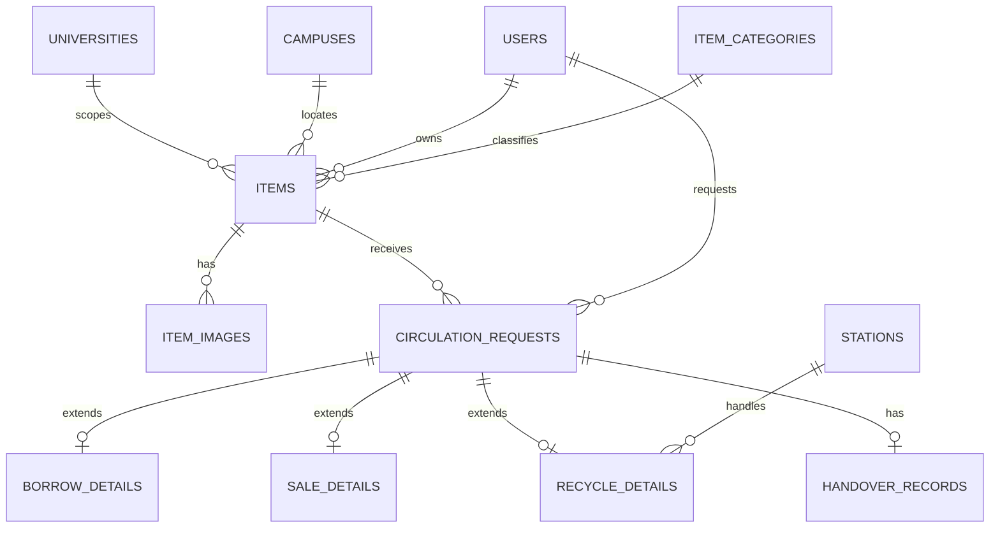
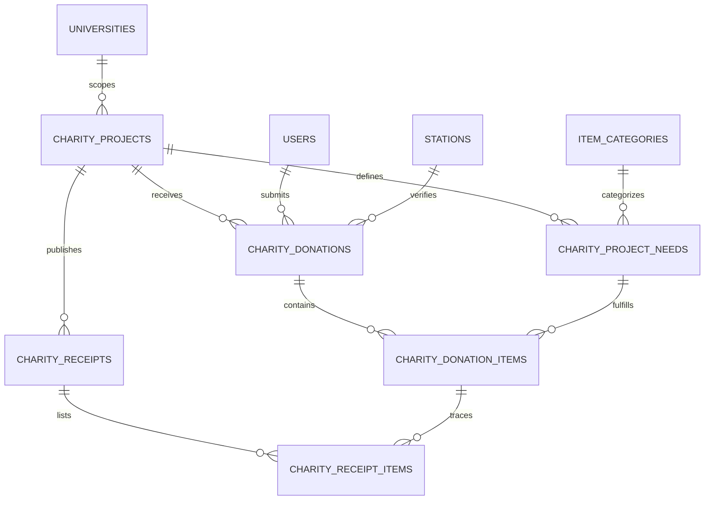
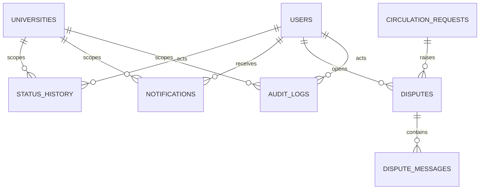

# 青禾流转 6.2 概念数据模型与 ER 图

| 项目 | 内容 |
|---|---|
| 文档编号 | DES-DATA-001 |
| 版本 | 1.0 |
| 日期 | 2026-11-19 |
| 状态 | 已批准并冻结 |
| AI 名称 | Codex |
| 需求依据 | SRS-001 |

## 1. 建模方法

本文档从需求规格说明书中提取名词，区分实体与属性，再依据“一个 X 对应几个 Y”确定关系。最终得到 27 张表。

实体的判定标准：

- 需要独立标识、生命周期或历史记录的对象建表。
- 只依附于单一主体、没有独立生命周期的简单值保留为字段。
- 同一物品的四类流转共用申请和交接主干，只在结束条件和专属属性上分表。
- 模拟支付不建立资金账户、流水或结算表，只保存模拟支付状态和快照价格。

## 2. 实体分组

| 分组 | 表 |
|---|---|
| 组织与账号 | `universities`、`campuses`、`users`、`stations`、`station_manager_assignments`、`student_import_batches`、`student_registry_records`、`login_verification_codes` |
| 物品与发布 | `item_categories`、`items`、`item_images` |
| 申请与履约 | `circulation_requests`、`borrow_details`、`sale_details`、`recycle_details`、`handover_records`、`status_history` |
| 治理与通知 | `notifications`、`disputes`、`dispute_messages`、`audit_logs` |
| 公益首版 | `charity_projects`、`charity_project_needs`、`charity_donations`、`charity_donation_items`、`charity_receipts`、`charity_receipt_items` |

## 3. 组织与账号 ER 图

<!-- docx-image: assets/er-identity.png -->

## 4. 物品与流转 ER 图

<!-- docx-image: assets/er-circulation.png -->

## 5. 公益 ER 图

<!-- docx-image: assets/er-charity.png -->

## 6. 治理 ER 图

<!-- docx-image: assets/er-governance.png -->

## 7. ER 到表核对

| 编号 | 表 | 职责 | 核心字段 | 关系与约束 |
| ---: | --- | --- | --- | --- |
| 1 | `universities` | 多高校租户根和四川省高校目录 | `id`、`code`、`name`、`province`、`city`、`education_level`、`ownership`、`source_url` | 被所有业务对象引用 |
| 2 | `campuses` | 校内校区 | `university_id`、`code`、`name`、`address`、`is_primary`、`verification_status` | 属于高校；单校区高校使用学校全称作为校区名 |
| 3 | `users` | 四类登录身份统一账号 | `university_id`、`campus_id`、`login_name`、`student_no`、`phone_hash`、`password_hash`、`nickname`、`avatar_object_key`、`role` | 学生和管理员账号范围不同；平台管理员为全局账号 |
| 4 | `stations` | 回收/公益服务点 | `university_id`、`campus_id`、`name`、`station_type`、`status` | 属于高校和校区 |
| 5 | `station_manager_assignments` | 管理员与站点授权关系 | `station_id`、`user_id`、`started_on`、`ended_on`、`status` | 同一账号同一站点只能有一条有效授权 |
| 6 | `student_import_batches` | 学生名单导入批次 | `university_id`、`uploaded_by_user_id`、`file_sha256`、`success_rows`、`failed_rows`、`status` | 不保存原始名单文件，只保存摘要和结果 |
| 7 | `student_registry_records` | 注册核验名单 | `student_no`、`full_name`、`phone_hash`、`campus_id`、`grade`、`class_name`、`major`、`college`、`registered_user_id` | 学号与手机号在高校内唯一 |
| 8 | `login_verification_codes` | 模拟手机验证码 | `user_id`、`code_hash`、`expires_at`、`used_at`、`failed_attempts` | 60 秒有效、一次性、服务端校验 |
| 9 | `item_categories` | 物品分类 | `slug`、`name`、`display_order`、`is_active` | 供物品和公益需求共用 |
| 10 | `items` | 可流转物品主记录 | `university_id`、`campus_id`、`owner_user_id`、`category_id`、`mode`、`title`、`condition`、`status`、`sale_price_cents` | 一个物品只能处于一种模式；同一时刻最多一个进行中申请 |
| 11 | `item_images` | 物品图片 | `item_id`、`object_key`、`content_type`、`byte_size`、`sort_order` | 最多 5 张；数据库保存 R2 对象 key |
| 12 | `circulation_requests` | 四类流转统一申请 | `item_id`、`requester_user_id`、`owner_user_id`、`mode`、`status`、`request_note` | 模式必须与物品模式一致；活动申请对物品唯一 |
| 13 | `borrow_details` | 借用专属字段 | `request_id`、`start_date`、`due_date`、`return_note`、`returned_at` | 与申请一对一；结束日期不早于开始日期 |
| 14 | `sale_details` | 出售与模拟支付字段 | `request_id`、`agreed_price_cents`、`payment_status`、`paid_at` | 只记录模拟状态，不产生真实资金流水 |
| 15 | `recycle_details` | 回收站点与验收字段 | `request_id`、`station_id`、`preferred_start_at`、`preferred_end_at`、`inspection_status`、`inspection_note` | 与申请一对一；公益管理员只能处理本站记录 |
| 16 | `handover_records` | 一次性交接凭证 | `request_id`、`code_hash`、`code_version`、`generated_by_user_id`、`expires_at`、`consumed_at`、`status` | 每笔申请最多一条当前交接记录；旧码重生成后失效 |
| 17 | `status_history` | 关键状态历史 | `university_id`、`entity_type`、`entity_id`、`from_status`、`to_status`、`actor_user_id`、`reason` | 只追加，不更新或删除历史 |
| 18 | `notifications` | 站内通知 | `recipient_user_id`、`category`、`title`、`body`、`related_entity_type`、`related_entity_id`、`read_at` | 只在本校范围内可见 |
| 19 | `disputes` | 争议主记录 | `circulation_request_id`、`opened_by_user_id`、`reason`、`status`、`resolution`、`resolved_by_user_id` | 与流转申请关联，管理员记录处理结论 |
| 20 | `dispute_messages` | 争议双方说明 | `dispute_id`、`author_user_id`、`body`、`attachment_object_key` | 只追加；参与双方和管理员可查看 |
| 21 | `audit_logs` | 关键操作审计 | `actor_user_id`、`action`、`entity_type`、`entity_id`、`detail`、`created_at` | 记录导入、审核、争议、权限和状态变更 |
| 22 | `charity_projects` | 公益项目主记录 | `university_id`、`title`、`recipient_org`、`deadline`、`status`、`public_summary` | 本校用户可查看；到期或完成后停止新捐赠 |
| 23 | `charity_project_needs` | 公益项目物资目标 | `project_id`、`item_category_id`、`item_name`、`target_quantity`、`accepted_quantity`、`unit` | 已接收数量不得大于目标数量 |
| 24 | `charity_donations` | 一次实物捐赠的抬头 | `project_id`、`donor_user_id`、`station_id`、`status`、`reviewed_by_user_id` | 只有核验接收后计入项目进度 |
| 25 | `charity_donation_items` | 捐赠物资明细 | `donation_id`、`project_id`、`project_need_id`、`quantity`、`accepted_quantity`、`image_object_key` | 明细必须属于同一项目与需求项 |
| 26 | `charity_receipts` | 公益回执抬头 | `project_id`、`station_id`、`recipient_org`、`received_at`、`public_note`、`status` | 发布后本校用户可查看 |
| 27 | `charity_receipt_items` | 回执物资明细 | `receipt_id`、`donation_item_id`、`item_name`、`quantity` | 回执物资可追溯到已接收捐赠明细 |

## 8. 关系口径

| 关系 | 基数 | 说明 |
|---|---|---|
| 高校—校区 | 1:N | 单校区高校也至少有一条校区记录 |
| 高校—用户 | 1:N | 学生、公益管理员和校级管理员必属于高校；平台管理员不属于单一高校 |
| 用户—物品 | 1:N | 用户只能编辑自己发布的物品 |
| 物品—图片 | 1:N | 首版最多 5 张 |
| 物品—流转申请 | 1:N | 历史申请可有多条，活动申请最多一条 |
| 流转申请—借用/出售/回收明细 | 1:0..1 | 赠送不需要专属明细表 |
| 流转申请—交接记录 | 1:0..1 | 审批后生成，确认后标记使用 |
| 公益项目—需求项 | 1:N | 一个项目可募集多种物资 |
| 公益捐赠—物资明细 | 1:N | 支持一次捐赠多种物资 |
| 公益回执—回执明细 | 1:N | 一次发放可对应多条物资 |

## 9. 不单独建表的对象

| 对象 | 处理方式 | 理由 |
|---|---|---|
| 手机验证码有效期 | `login_verification_codes.expires_at` | 单次凭证，不需要额外生命周期表 |
| 交接码版本 | `handover_records.code_version` | 重新生成时在原记录上递增，旧哈希立即失效 |
| 模拟支付流水 | `sale_details.payment_status` | 首版不对应真实账户、余额或资金流水 |
| 环保贡献数 | 以已完成回收申请聚合计算 | 不保存可被手工篡改的冗余积分 |
| 物品当前联系人 | 从发布者与申请双方关系取得 | 不重复存联系人快照 |
| 校园地图和位置坐标 | 首版不实现 | 仅保存校区和站点文字地址 |

## 10. 变更记录

| 版本 | 日期 | 变更 |
|---|---|---|
| 1.0 | 2026-11-19 | 建立 27 张表的概念模型、ER 图和实体关系核对 |
