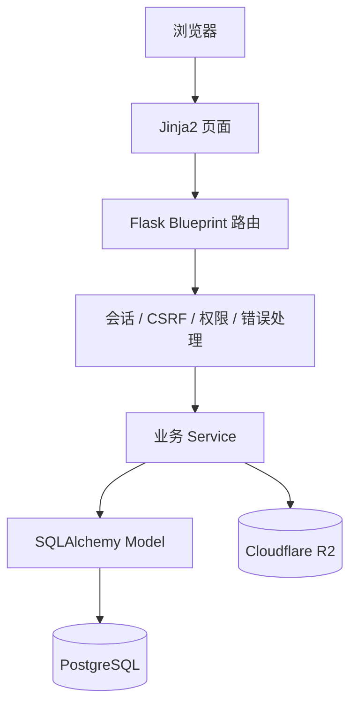
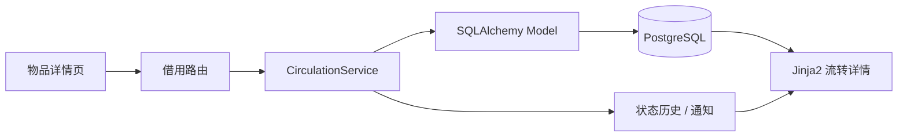
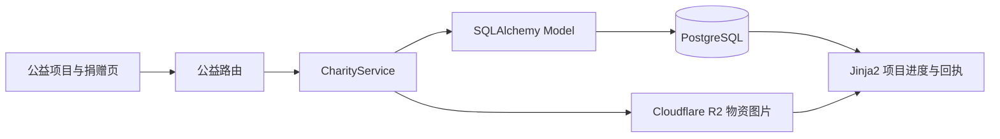

# 青禾流转 6.2 系统架构与模块设计说明书

| 项目 | 内容 |
|---|---|
| 文档编号 | DES-ARCH-001 |
| 版本 | 1.2 |
| 日期 | 2026-11-22 |
| 状态 | 已批准（G5 架构已同步） |
| 技术栈 | Python 3.13、Flask 3、Jinja2、Flask-SQLAlchemy、PostgreSQL 18、R2 |

## 1. 架构结论

系统采用单体的分层服务端渲染架构。浏览器访问 Flask 路由，路由只处理请求和模板，业务权限、状态转换和事务由 service 模块执行，SQLAlchemy 访问 PostgreSQL，图片通过独立存储适配器写入 Cloudflare R2。

首版不拆分前后端，不提供 REST API，不引入消息队列、微服务和第二套状态来源。G5 在同一分层内增加校级管理员、阿里云短信认证 Provider 和平台运维安全中心。

## 2. 分层架构

<!-- docx-image: assets/architecture-layers.png -->

## 3. 模块划分

| 模块 | 主要使用角色 | 主要业务 | 维护表 |
|---|---|---|---|
| 身份与准入 | 所有角色 | 身份选择、学校校区选择、注册、图形码、PNVS/Mock 短信认证、两种登录、资料 | `users`、`universities`、`campuses`、`student_import_batches`、`student_registry_records`、`registration_verification_requests`、`login_verification_codes` |
| 校园组织 | 平台管理员、公益管理员 | 高校、校区、站点和公益管理员站点授权 | `universities`、`campuses`、`stations`、`station_manager_assignments` |
| 物品与媒体 | 在校学生、平台管理员 | 发布、分类、图片、浏览、编辑、下架 | `item_categories`、`items`、`item_images` |
| 流转申请 | 在校学生、公益管理员 | 借用、出售、赠送、回收的申请和模式规则 | `circulation_requests`、`borrow_details`、`sale_details`、`recycle_details` |
| 交接与异常 | 在校学生、公益管理员、平台管理员 | 交接码、归还、取消、争议、状态历史 | `handover_records`、`disputes`、`dispute_messages`、`status_history` |
| 公益首版 | 在校学生、公益管理员 | 项目、需求、实物捐赠、核验、回执 | `charity_projects`、`charity_project_needs`、`charity_donations`、`charity_donation_items`、`charity_receipts`、`charity_receipt_items` |
| 通知与审计 | 所有角色 | 站内通知和关键操作记录 | `notifications`、`audit_logs` |

说明：账号与权限也会出现在每个业务模块中，但只在“身份与准入”模块维护账号本身；其他模块只消费当前登录主体和权限结果。

## 4. 模块穿线卡

### 4.1 身份与准入

- 主要角色：所有角色。
- 业务起点与终点：选择登录身份开始，建立有效登录会话后结束；账号停用时退出。
- 公开接口：选择身份、学生学校校区选择、注册、密码登录、验证码登录、载入当前用户、修改资料、导入学生名单、导入管理账号。
- 核心规则：只有学生可自主注册；名单匹配；学生账号必须属于所选学校；短信码 60 秒重发、300 秒有效；生产禁止 Mock。
- 上游：身份选择页、学校校区页、登录/注册表单、平台管理员名单导入。
- 下游：其他所有模块只接收已认证的 `CurrentUser`。
- 验收：冒领注册、错学校访问、错角色访问、管理员自主注册和重复学号均失败。

### 4.2 校园组织

- 主要角色：平台管理员、公益管理员。
- 业务起点与终点：高校/校区/站点创建开始，停用或授权结束结束。
- 公开接口：维护高校、维护校区、维护站点、分配公益管理员、查询本校组织树。
- 核心规则：平台管理员全局；公益管理员只能看被分配站点。
- 上游：平台管理页面。
- 下游：物品发布、回收申请、公益捐赠和统计。
- 验收：停用校区不能发布新物品；不能把站点授权给其他学校账号。

说明：G5 起校级管理员按 `university_id` 使用本校概览、组织、账号名单、审核、争议与审计接口，不能跨校。

### 4.3 物品与媒体

- 主要角色：在校学生、平台管理员。
- 业务起点与终点：物品创建开始，完成、下架或冻结结束。
- 公开接口：创建物品、搜索本校物品、读取详情、编辑物品、下架/重新上架、上传图片。
- 核心规则：一个物品只能有一种模式；有活动申请时不能修改关键字段；最多 5 张图片且单张不超过 3 MB。
- 上游：在校学生发布页、平台管理员审核页。
- 下游：流转申请读取物品模式、高校、校区和所有者。
- 验收：跨学校不可见；图片失败有明确提示且不留下临时地址。

### 4.4 流转申请

- 主要角色：在校学生、公益管理员。
- 业务起点与终点：申请人提交申请开始，拒绝/取消/完成结束。
- 公开接口：提交借用/购买/领取/回收申请、查看我的申请、接受/拒绝、模拟支付、提交归还、回收验收。
- 核心规则：申请模式与物品模式一致；同一物品只有一个活动申请；不允许自我申请；跨校拒绝。
- 上游：物品详情和我的物品。
- 下游：交接、通知、状态历史、审计。
- 验收：四种模式各自有一条完整正常链和至少一条拒绝/取消链。

### 4.5 交接与异常

- 主要角色：申请双方、公益管理员、平台管理员。
- 业务起点与终点：交接码生成开始，交接成功或取消/争议处理结束。
- 公开接口：生成交接码、确认交接、取消申请、发起争议、追加说明、管理员处理争议。
- 核心规则：6 位一次性码、10 分钟有效、同校双方、服务端校验当前状态。
- 上游：已接受的流转申请。
- 下游：状态历史、通知、审计和物品最终状态。
- 验收：错误码、过期码、旧版本码、越权用户和重复确认都不推进状态。

### 4.6 公益首版

- 主要角色：在校学生、公益管理员。
- 业务起点与终点：公益项目发布开始，项目完成/截止并发布回执结束。
- 公开接口：创建项目、维护物资需求、提交捐赠、核验捐赠、查看进度、创建/发布回执。
- 核心规则：只接受实物；本校范围；站点核验后计数；不得超募；回执必须脱敏。
- 上游：公益管理员项目管理页、在校学生公益页。
- 下游：项目进度、回执公示、通知和审计。
- 验收：达到目标或截止后停止新捐赠；无资金入口；回执可追溯到接收明细。

### 4.7 通知与审计

- 主要角色：所有角色。
- 业务起点与终点：业务动作产生通知或审计记录开始，记录写入结束。
- 公开接口：发送业务通知、读取通知、标记已读、记录审计事件、管理员查询审计。
- 核心规则：通知限本校接收人；审计写操作与业务事务保持一致。
- 上游：各 service 内部调用。
- 下游：通知列表、管理员审计页面。
- 验收：关键写操作有操作者、对象和时间；错误日志不含密码、验证码和手机号。

## 5. Service 接口边界

以下接口是实现阶段的稳定 seam。Route 只能通过这些接口触发业务规则。

| 模块 | 接口 |
|---|---|
| 身份与准入 | `get_student_context()`、`register_student()`、`authenticate_password()`、`issue_login_code()`、`verify_login_code()`、`load_current_user()`、`update_profile()`、`import_students()`、`import_managed_accounts()` |
| 校园组织 | `list_universities()`、`create_university()`、`update_university()`、`list_campuses()`、`create_campus()`、`update_campus()`、`create_station()`、`assign_station_manager()`、`manager_scope()`、`get_organization_tree()` |
| 物品与媒体 | `create_item()`、`search_items()`、`get_visible_item()`、`update_item()`、`change_item_shelf_state()` |
| 流转申请 | `request_borrow()`、`request_purchase()`、`request_giveaway()`、`request_recycle()`、`decide_request()`、`simulate_payment()`、`submit_return()`、`confirm_return()`、`inspect_recycle()` |
| 交接与异常 | `issue_handover_code()`、`confirm_handover()`、`cancel_request()`、`open_dispute()`、`add_dispute_message()`、`resolve_dispute()` |
| 公益首版 | `create_project()`、`update_project_need()`、`submit_donation()`、`review_donation()`、`publish_receipt()` |
| 通知与审计 | `notify()`、`list_notifications()`、`mark_notification_read()`、`record_audit()` |

接口同时约束参数、权限、当前状态、事务和错误结果。页面隐藏按钮不能替代 service 校验。

## 6. 关键数据流

### 6.1 借用申请到归还

<!-- docx-image: assets/dataflow-borrow.png -->

完整业务顺序：

1. 用户在物品详情页提交借用日期和说明。
2. 路由完成字段解析后调用 `CirculationService.request_borrow()`。
3. Service 校验高校、申请人、物品模式、当前状态和日期冲突。
4. Service 在同一事务中写入申请、状态历史、物品占用和通知。
5. 出借人接受后生成一次性交接码；接收方确认成功后进入借用中。
6. 借用人提交归还；出借人确认完成或发起争议。
7. 所有状态变化都通过 Model 写入 PostgreSQL，页面读取同一状态渲染。

### 6.2 公益捐赠到回执

<!-- docx-image: assets/dataflow-charity.png -->

完整业务顺序：

1. 公益管理员创建公益项目和物资需求目标。
2. 在校学生查看剩余数量并提交实物、数量和图片。
3. 公益管理员核验；拒绝时记录原因，不增加进度。
4. 接收时锁定需求行，在确认不超募后增加已接收数量。
5. 项目达到目标或截止后停止新捐赠，并登记发放和接收组织。
6. 公益管理员创建脱敏回执；发布后本校学生可查看。
7. 图片对象写入 R2，业务记录只保存对象 key；进度和回执保存在 PostgreSQL。

## 7. 事务边界

- 接受申请、切换状态、生成交接码和通知在同一事务内完成。
- 确认交接锁定申请和交接记录；重复提交只能成功一次。
- 公益核验锁定需求行，成功后才能增加 `accepted_quantity`。
- R2 上传先完成对象写入，再在数据库保存 key；数据库保存失败时记录待清理对象，不把本地临时路径写入数据库。
- 状态历史与业务状态在同一事务提交。

## 8. 部署架构

| 层 | 课程本地 | 公网演示 |
|---|---|---|
| Web | Flask 开发服务器 | Vercel Python Function |
| 数据库 | 本地 PostgreSQL 18 | Neon PostgreSQL |
| 图片 | 本地 fake storage 或临时目录 | Cloudflare R2 |
| 短信认证 | Mock Provider | 阿里云 PNVS 短信认证 |
| 边缘防护 | Flask 应用层频控 | Vercel + 应用层安全事件和临时封禁；Cloudflare WAF 暂缓 |
| 页面 | Jinja2 | 同一套 Jinja2 模板 |

环境变量、密钥和 R2 凭据只从环境读取，不写入代码或文档。

## 9. 架构验收

| 检查项 | 验收标准 |
|---|---|
| 分层 | Route 不直接写状态，Template 不查询数据库 |
| 权限 | 每个业务 service 都有高校和角色校验 |
| 事务 | 关键写操作只有一个事务边界 |
| 模块深度 | 调用方不需要了解内部表组合和状态细节 |
| 存储 seam | 测试使用 fake，生产使用 R2 适配器 |
| 可部署 | Vercel、Neon、R2 的边界均有明确配置项 |

## 10. 变更记录

| 版本 | 日期 | 变更 |
|---|---|---|
| 1.0 | 2026-11-19 | 建立分层架构、模块职责、service 接口和关键数据流 |
| 1.1 | 2026-11-19 | 补齐管理账号和校园组织 service 接口，移除校级管理员首版职责冲突 |
| 1.2 | 2026-11-22 | 同步 G5 校级管理员、阿里云短信、运维安全与 Cloudflare WAF 暂缓状态 |
