# 青禾流转 6.2 UI 规范与页面原型

| 项目 | 内容 |
|---|---|
| 文档编号 | DES-UI-001 |
| 版本 | 2.5 |
| 日期 | 2026-11-21 |
| 状态 | 已批准并冻结；2.5 为学校实时搜索修复 |
| 页面形态 | Web-only，桌面优先，基础响应式 |
| 交互原型 | `prototype/index.html` |

## 1. 品牌与固定文案

| 项目 | 固定内容 |
|---|---|
| 中文名 | 青禾流转 |
| 英文名 | Qinghe Circle Campus |
| 副标题 | 校园物品共享流转与绿色回收平台 |
| 首页标语 | 让每一件好物，都遇见下一位需要的人 |

| 板块 | 固定标语 |
|---|---|
| 共享借还 | 有些东西，不必拥有也能用好 |
| 二手交易 | 换个主人，好物继续发光 |
| 免费赠送 | 你放下的，也许正是别人寻找的 |
| 绿色回收 | 校园旧物的下一段故事 |
| 公益捐赠 | 让闲置走出宿舍，让善意抵达远方 |
| 公益项目 | 每一份小小善意，都有清楚的去向 |
| 我的流转 | 每一次流转，都有来处，也有归处 |
| 发布物品 | 给闲置一个继续被需要的机会 |
| 物品交接 | 准时赴约，是物品与人之间的信任 |
| 评价反馈 | 让真实的声音，陪下一次相遇更安心 |
| 环保贡献 | 多留住一件物品，就多留下一份价值 |

公益子模块：

| 子模块 | 固定标语 |
|---|---|
| 爱心物资捐赠 | 让闲置走出宿舍，让善意抵达远方 |
| 公益义卖 | 一次交易，也可以是一次帮助 |
| 微心愿项目 | 为一个小小心愿，凑齐一份需要 |
| 公益回执与公示 | 每一份善意，都能看见去向 |

首版导航不显示公益义卖入口，也不显示不可用占位按钮。

## 2. 视觉方向

### 2.1 A 青禾发现

采用清爽的校园生活视觉。主视觉使用中国校园场景短视频，操作色采用蓝青色，珊瑚色只用于价格、提醒和重点动作；四类流转作为清楚的多选项进入首屏。物品卡已改用书本、台灯、球拍、音箱等真实物品照片，不再依赖连续渐变圆斑占位。人物场景优先使用中国大陆、香港、澳门、台湾、韩国、新加坡和日本的东亚人物素材；界面与图片语义以简体中文为主。布局参考成熟市场和内容网站：真实图片先建立信任，搜索与筛选紧贴结果，模块之间通过尺寸和留白形成层级。

### 2.2 B 流转清单

更接近工具型工作台。左侧固定筛选，右侧是高密度列表，适合高频找物。效率高，但情绪表达弱于 A。

### 2.3 C 校园拾光册

更接近视觉化市集。用不规则尺寸的物品卡片和编辑式标本签，感染力强，但高密度内容容易变拥挤。

### 2.4 采用结论

正式页面采用 A“青禾发现”作为主方向，保留 B 的清楚筛选层级。C 只用于首页推荐区和公益项目展示，不用于业务操作页。三个方向均在原型中可切换查看。参考站点与取舍见 `08-visual-reference-research.md`。

第二轮视觉修订继续沿用 A，不新增第四种方向：

- 发现页主视觉加入可暂停的中国校园日常视频；物品列表之后增加“第二次被选择”编辑式图文区，用东亚学生、书本和校园学习场景承接“继续使用”的叙事。
- 公益主视觉改为无外文标牌的物资整理视频，左侧保留深色可读区；视频下方集中展示项目目标、公开回执和中国乡村课堂、图书馆与小学课堂场景。
- 场景素材明确标为“场景示意”，不得暗示项目已经完成照片中的线下活动。
- 单色块只用于承担品牌叙事、动作和状态，不用连续同构色块填充长页面；推荐区保留一个编辑式品牌块，其余位置使用有具体内容的照片。

### 2.5 动效与媒体规则

| 场景 | 动效 | 目的 | 降级 |
|---|---|---|---|
| 页面切换 | 260 ms 淡入、160 ms 淡出 | 保持导航空间连续 | `prefers-reduced-motion` 下近似即时 |
| 首屏内容 | 380 ms 分段上升，延迟 0–140 ms | 建立清楚的阅读顺序 | 直接显示最终状态 |
| 首屏视频/照片 | 视频静音循环；指针移动时更新柔和光斑位置 | 建立校园现场感与画面深度，不改变布局 | 减少动效时显示海报并隐藏光斑 |
| 物品与图文卡 | 滚动进入后 420–520 ms 显现 | 提示新内容进入视口 | 直接显示 |
| 物品卡交错显现 | 同列相邻卡延迟 55–110 ms | 让浏览顺序更易跟随，避免同时闪出 | 取消延迟并直接显示 |
| 物品卡悬停 | 图片 520 ms 轻缩放，卡片上移 3 px | 反馈当前指向，不改变卡片尺寸 | 减少动效时不做位移和缩放 |
| 公益进度 | 720 ms 从左侧生长 | 让数量和目标关系更易读 | 直接显示最终进度 |
| 两处主题视频 | 静音循环，提供至少 44×44 px 的播放/暂停按钮 | 展示校园与公益物资现场，并允许随时停止 | 减少动效时只显示海报，不自动播放 |
| 校园校徽控件 | 徽章按实际图形裁边并居中，图片与 44×44 px 圆框同宽高 | 消除透明留白造成的徽标缩小，同时保留播放/暂停热区 | 保持宽高比，不使用拉伸变形 |

视频来源、公开许可证和“场景示意”限制记录在 `assets/credits.json`。视频和图片都必须保存在项目内，不依赖第三方热链。
五所示范高校的徽章按钮均经过浏览器检查，图片渲染尺寸与圆框一致，校徽保持居中且不伸入圆形边界之外。

### 2.6 发布后界面一致性维护

- 业务页面、身份页面和登录页共用 `tokens.css` 语义令牌，浅色与深色主题只切换令牌，不在页面中复制第二套配色。
- 主色收敛为校园蓝，雾白承担大面积背景，禾绿只用于循环、成功和辅助强调；保留珊瑚色表达价格与风险提醒。
- 工作区标题采用宋体感显示字体，正文保持高可读无衬线字体，避免企业 SaaS 模板感。
- 登录页身份切换收进右上角可展开面板；用户确认后进入既有身份、学校校区和登录流程，不改变权限或回跳规则。
- 桌面登录页在常见横屏视口完整展示主要表单；手机保持自然纵向滚动。

### 2.7 登录页原地身份切换

- 官方入口在未登录且未选择身份时直接进入新版登录页，不使用独立旧身份卡片，也不先跳转身份页。
- 未选择身份时显示“未选择身份”提示、禁用账号和密码输入，并保留右上角“切换身份”入口。
- 身份面板使用四项原生单选项；选中后角色标签、账号字段、说明卡片、注册入口和表单提交身份立即更新，不产生页面跳转。
- 学生仍必须先选择学校和校区；切换为学生身份后，账号说明区显示学校校区入口，不绕过 BR-044 与 FR-A08。
- 身份选择必须同步写入会话；学校校区与注册链接在同步完成后再跳转，避免服务端误判未选择身份。
- 桌面登录页在 700 px 以上视口隐藏页面滚动条，内容完整落在单屏内；宽度 820 px 以下保持自然滚动。

### 2.8 学校与校区选择页

- 页面采用与登录页一致的左右双栏结构，但不复制登录页圆环插画，也不改动全局颜色、字体和主题令牌。
- 左侧为“校园坐标网络”原创 CSS/SVG 动画：学校识别卡、校区节点、流动路线与校园建筑轮廓共同解释“先选学校，再选校区，再进入学生登录”。
- 右侧保留学校搜索、学校下拉、校区联动、当前选择摘要与提交按钮；校区未匹配时禁用，学校和校区齐全后才允许继续。
- 桌面端在 1867×933 与 1366×768 完整显示；手机端折叠左侧动画，保留完整表单和自然纵向滚动。
- 学校数量使用真实查询结果，不使用虚构计数；单校区高校继续显示学校全称。

### 2.9 学生注册页

- 注册页采用与学校校区页一致的双栏结构，左侧使用新的“学生身份核验卡”UI 动画，包含扫描线、核验状态、进度光带、学号归属、手机号匹配和密码安全存储提示。
- 左侧文案使用价值与隐私语义，不使用“第一步、第二步”式流程罗列；右侧保留原注册字段、名单带入说明、密码规则、字段错误、CSRF 和 `next` 回跳。
- 左侧动画不显示具体学校、校区或测试校名，避免示例数据进入品牌叙事；真实学校与校区只在右侧当前范围卡片中按业务数据显示。
- 学校校区页保留“找到你的校园坐标”主标题，左侧节点改为同校可见、校区覆盖和可信交接，不再显示步骤编号。
- 两页均复用 D-044 至 D-046 的颜色、字体、主题和桌面无滚动条规则，不修改全局令牌。
- 学生在登录页尚未选择学校校区时点击“前往学生注册”，页面原位提示“请先选择学校和校区”，不进入注册页；学校校区绑定完成后恢复注册跳转。
- 学校搜索使用实时组合框，输入任意单字或连续关键字都会展示匹配学校；原生选择字段仅作为表单兼容层，不在界面上重复显示。

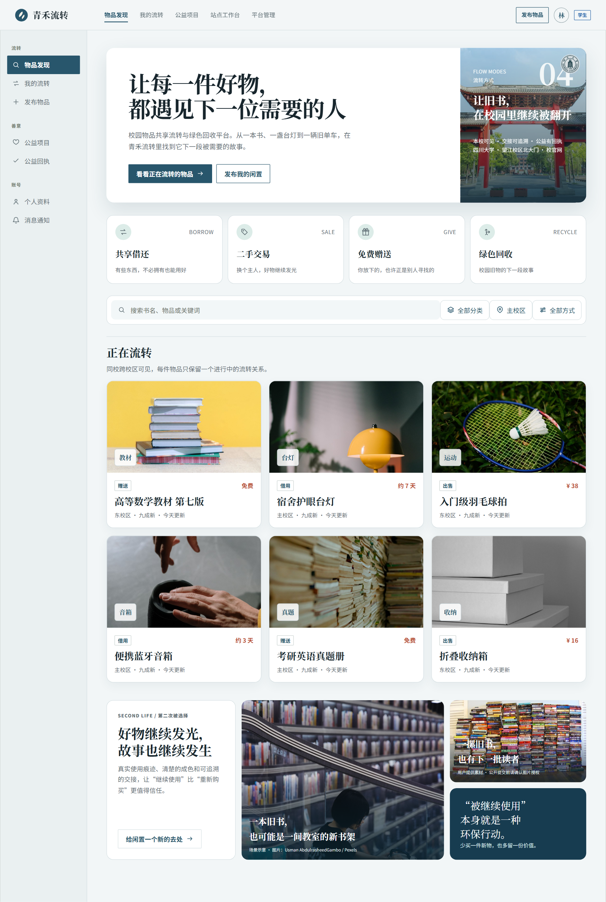

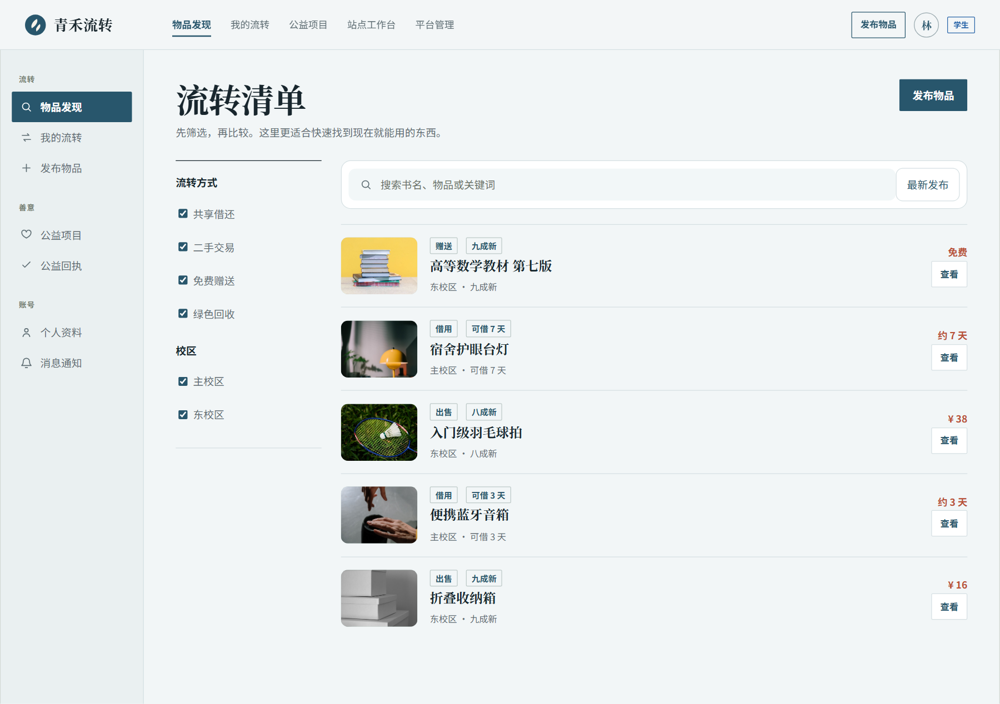

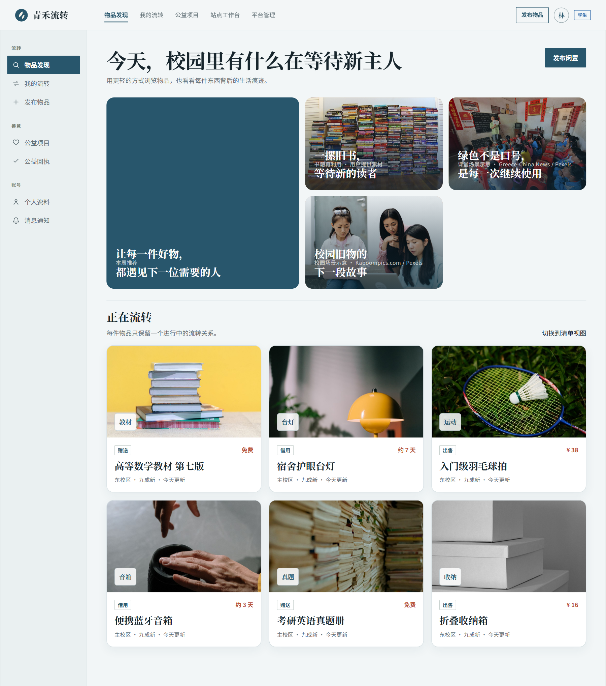

## 3. 风格约定卡

| 项目 | 规范 |
|---|---|
| 主色 | 鲜亮校园蓝 `#0B63F6`；深色主题由语义令牌映射为浅蓝强调 |
| 辅助色 | 晴空蓝 `#62C8FF`，淡青蓝 `#EAF2FF`，禾绿只用于成功和循环辅助 |
| 背景 | 雾白 `#F3F7FB`，纸面 `#FFFFFF`，分隔底 `#DFE9F3` |
| 人情味强调 | 珊瑚红 `#B5573F` |
| 正文 | 蓝黑 `#172637`，次级文字 `#607184` |
| 状态色 | 成功 `#2D7A4F`，提醒 `#9A6619`，危险 `#A33A32`，信息 `#0B63F6` |
| 角色标签 | 学生蓝色 `#0B63F6`；公益管理员（回收）橙色 `#A76512`；平台管理员红色 `#B53A2D`；校级管理员预留为灰紫色 `#6B647F` |
| 标题字体 | `"Noto Serif SC", "Source Han Serif SC", "STSong", "Songti SC", serif` |
| 正文字体 | `"Noto Sans SC", "Microsoft YaHei", "PingFang SC", sans-serif` |
| 数字字体 | `"Cascadia Code", "Consolas", monospace` |
| 正文大小 | 桌面 15–16 px；移动 14–15 px |
| 标题层级 | 48/32/24/19/16 px，按页面层级递减；桌面首屏标题不超过 62 px |
| 间距 | 4、8、12、16、24、32、48、64 px |
| 圆角 | 主视觉和卡片 14–18 px；按钮、输入框 10 px；标签 7 px |
| 阴影 | 只用于首屏主视觉、物品卡和 sticky 操作区；普通内容依靠浅色底和留白 |
| 图标 | 使用统一 SVG 线性图标，线宽 1.8 px；不使用 Emoji 或字符代替结构图标 |
| 图片 | 采用有明确许可的真实校园、东亚学生和物品照片；当前原型不要求加载外部热链图片 |

外部图片的作者、素材页、许可证与修改记录见 `assets/credits.json`；UI 参考来源与取舍见 `08-visual-reference-research.md`。

按钮规则：

- 主按钮：湖蓝实底、白字，只用于当前页面最重要的一个动作。
- 次按钮：透明底、湖蓝边框。
- 危险按钮：红字红框，二次确认。
- 禁用按钮：降低对比度，并解释不可用原因。

## 4. 页面骨架

- 公开页：品牌标志、登录/注册入口、公益说明。
- 学生工作区：桌面为左侧目录导航 + 顶部操作栏；移动端改为底部三项主导航。
- 工作台：页面标题、状态摘要、待办区、数据区，不将全页面做成卡片墙。
- 详情页：左侧主体信息，右侧 sticky 操作区；移动端操作区移动到正文之后。
- 表单页：字段分组、就地错误、底部主按钮；一次不展示超过 7 个必填项。
- 发现页：白色标题区 + 可暂停校园视频 + 四种流转多选项 + 搜索筛选 + 真实物品照片卡；图片负责叙事，文字和状态负责操作。
- 详情页：左为主体信息和编号封面，右为当前动作与一次性交接信息；当前状态始终在首屏可见。

## 5. 页面清单

| 页面 | 路径 | 核心内容 | 空态 | 错误态 |
|---|---|---|---|---|
| 身份选择 | `/auth/identity` | 用下拉框选择在校学生、公益管理员、平台管理员或校级管理员预留身份 | 不适用 | 身份无效 |
| 学生学校与校区 | `/auth/student-context` | 四川高校、学校全称、校区列表 | 暂无校区数据 | 学校或校区停用 |
| 登录 | `/auth/login` | 按身份进入不同登录界面 | 不适用 | 凭据错误、验证码过期、账号停用 |
| 注册 | `/auth/register` | 学号、手机号、密码和名单核验 | 不适用 | 非名单用户、手机号不符、重复账号 |
| 物品发现 | `/items` | 搜索、分类、模式、校区筛选和物品列表 | 暂无符合条件的物品 | 搜索失败可重试 |
| 物品详情 | `/items/<id>` | 图片、成色、模式、发布者、操作 | 图片缺失使用分类占位图 | 已下架、跨校、状态冲突 |
| 发布物品 | `/items/new` | 名称、分类、成色、模式、校区和图片 | 不适用 | 图片失败、价格缺失、日期缺失 |
| 我的物品 | `/me/items` | 活动、已完成、已下架筛选 | 还没有发布物品 | 加载失败可重试 |
| 我的申请 | `/me/requests` | 申请状态与下一步 | 还没有申请 | 当前状态不可操作 |
| 流转详情 | `/requests/<id>` | 时间线、交接码、取消、归还、争议 | 无历史时展示当前状态 | 过期码、越权、重复提交 |
| 公益项目 | `/charity` | 项目、目标、剩余和回执入口 | 暂无募集中项目 | 项目已截止 |
| 公益详情 | `/charity/<id>` | 目标物资、进度、接收组织和回执 | 暂无已接受捐赠 | 项目已结束 |
| 公益捐赠 | `/charity/<id>/donate` | 物资、数量、站点、说明和图片 | 不适用 | 超募、项目截止、图片失败 |
| 公益回执 | `/charity/receipts/<id>` | 物资、时间、接收组织和脱敏说明 | 暂无回执 | 回执未发布 |
| 个人资料 | `/me/profile` | 昵称、头像、角色标签 | 使用默认头像 | 上传失败 |
| 通知 | `/me/notifications` | 全部和未读筛选 | 暂无通知 | 加载失败 |
| 站点工作台 | `/station` | 今日待验收、待核验、项目进度 | 暂无待办 | 站点未授权 |
| 回收验收 | `/station/recycling` | 申请、送达时间、验收操作 | 暂无待验收 | 不能处理其他站点 |
| 公益核验 | `/station/donations` | 捐赠明细、数量、接收或拒绝 | 暂无待核验 | 超目标数量 |
| 公益回执管理 | `/station/receipts/new` | 接收组织、物资和时间 | 暂无可登记物资 | 回执未脱敏 |
| 平台概览 | `/admin` | 高校、用户、物品、流转和公益统计 | 数据为空 | 统计范围错误 |
| 组织管理 | `/admin/organizations` | 高校、校区、站点 | 暂无站点 | 校区归属冲突 |
| 学生名单导入 | `/admin/student-imports` | CSV 上传、错误行和批次 | 暂无批次 | 格式错误、重复号码 |
| 账号管理 | `/admin/users` | 角色、状态和测试账号 | 暂无账号 | 越权角色修改 |
| 内容审核 | `/admin/moderation` | 违规物品、原因和操作 | 暂无审核项 | 进行中业务冲突 |
| 争议处理 | `/admin/disputes` | 证据、双方说明和结论 | 暂无争议 | 已关闭争议不可重写 |
| 审计日志 | `/admin/audit` | 时间、操作者、动作和对象 | 暂无记录 | 日志不可删除 |

### 5.1 登录身份与学校校区选择

登录不是直接显示账号密码，而是先通过下拉框选择身份：

| 登录身份 | 后续入口 | 是否允许注册 |
|---|---|---|
| 在校学生 | 学校 → 校区 → 学生登录 | 允许，使用学号、手机号和密码 |
| 公益管理员（回收） | 公益管理员登录 | 不允许，由平台管理员导入 |
| 平台管理员 | 平台管理员登录 | 不允许，系统预置 1 个账号，不设总数上限 |
| 校级管理员（预留） | 校级管理员登录 | 不允许，由平台管理员导入，管理功能暂不开放 |

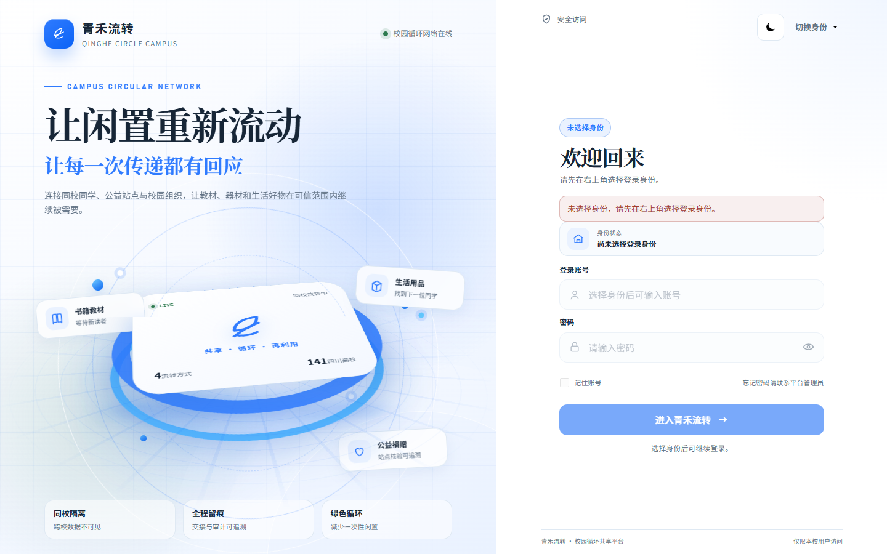

学生选择身份后进入学校与校区选择页。学校数据首批收录四川省普通高校；单校区高校的校区选项直接显示学校全称，多校区高校显示已登记校区。学校使用“输入即搜索”的一体化下拉控件，输入“四川”时实时列出四川开头的高校，不拆分独立搜索框。学校选择区保留“城市：所在城市”和“本科/专科”标签，不展示公办/民办、中外合作办学等办学性质标签；相关属性可保留在基础数据中供后台维护。

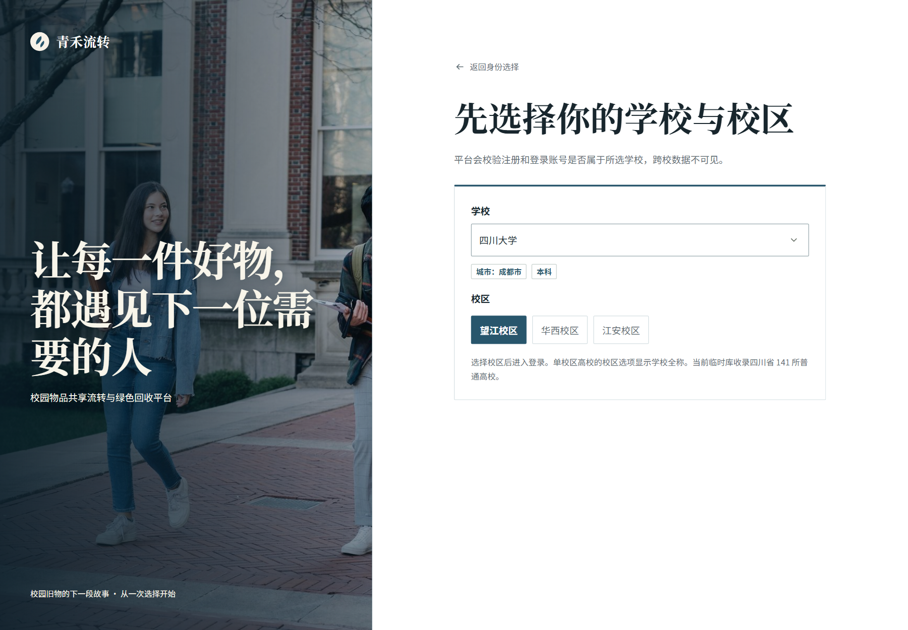

学生登录界面保留截图确定的标题和主标语，账号字段支持学号或手机号，注册提示固定为“还没有账号,前往注册”。

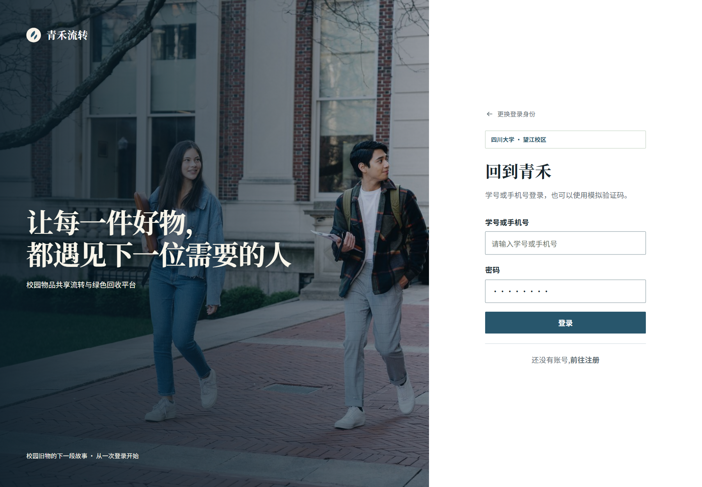

公益管理员、平台管理员和校级管理员登录页不显示注册入口，统一提示账号由平台管理员导入或系统预设。

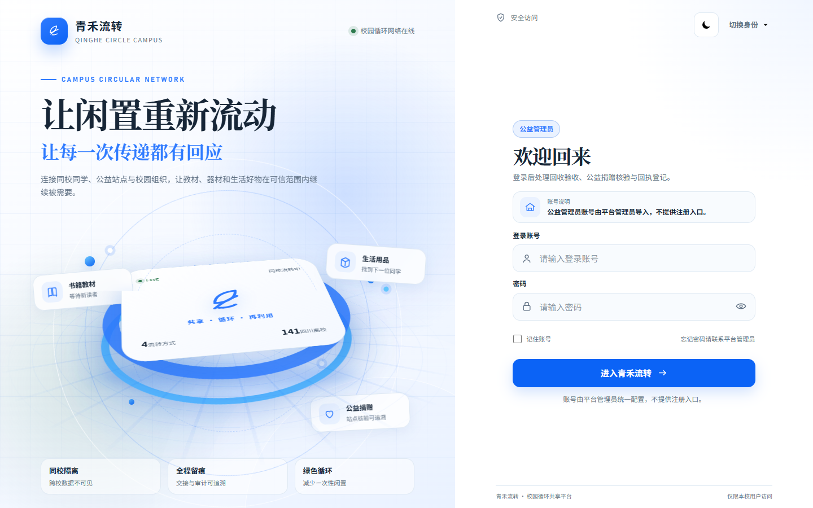

高校库来源为教育部 2025 年全国普通高等学校名单，当前录入四川省普通高校 141 所和 161 条校区记录。其中 10 所多校区高校的校区名已对照学校官网核验；其余学校暂以学校全称作为单校区名称，并标记为 `temporary`，后续可逐校核验替换。

## 6. 三个重点页面原型

### 6.1 列表型：物品发现

列表页面采用第 2.4 节确定的 A“青禾发现”结构，首页固定标语、可暂停校园视频、四类流转和当前物品列表在首屏阅读动线上。筛选条件保持在一行，移动端可堆叠。每个物品条目只显示当前状态、模式、校区、成色和一个明确信息层级，避免把业务状态藏在二级页面。物品图片只负责识别，不承担权限或状态表达。

### 6.2 表单型：公益实物捐赠

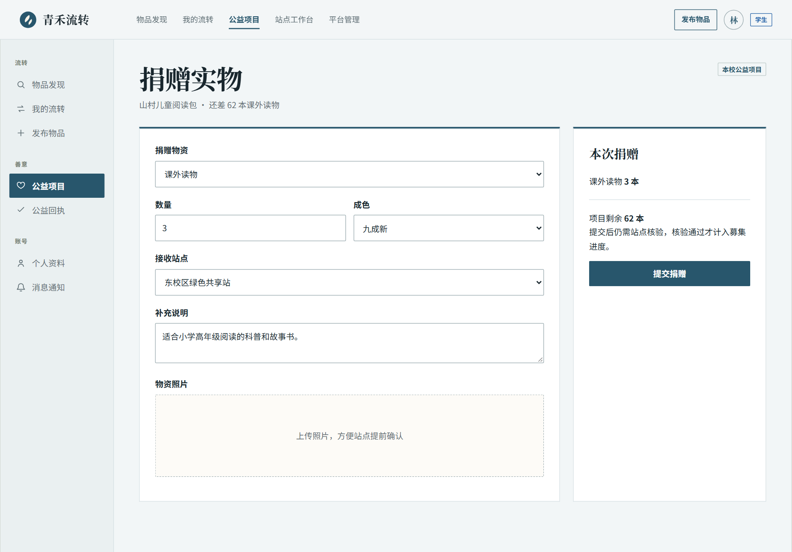

表单先说明项目目标与剩余数量，再让用户填写物资。提交按钮上方再次显示本次数量，避免“填到一半忘记目标”。验证码、支付、金额和公益金字段不存在。

### 6.3 状态型：我的流转详情

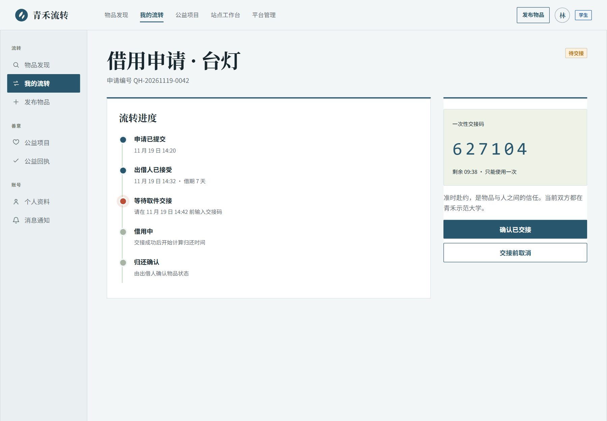

状态页使用纵向时间线表达旧状态、当前状态和下一步责任角色。交接码只在短时窗口显示并标出失效时间。取消、争议和归还按钮按当前状态出现，不展示不可用假按钮。

## 7. 其他角色页面

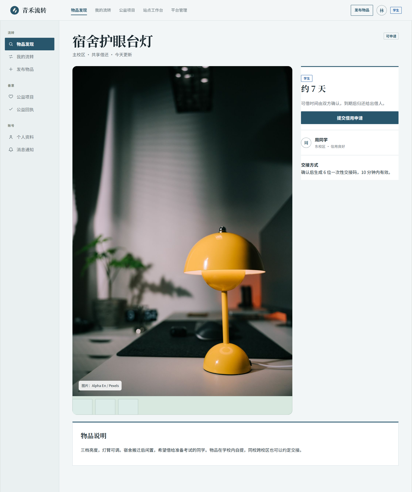

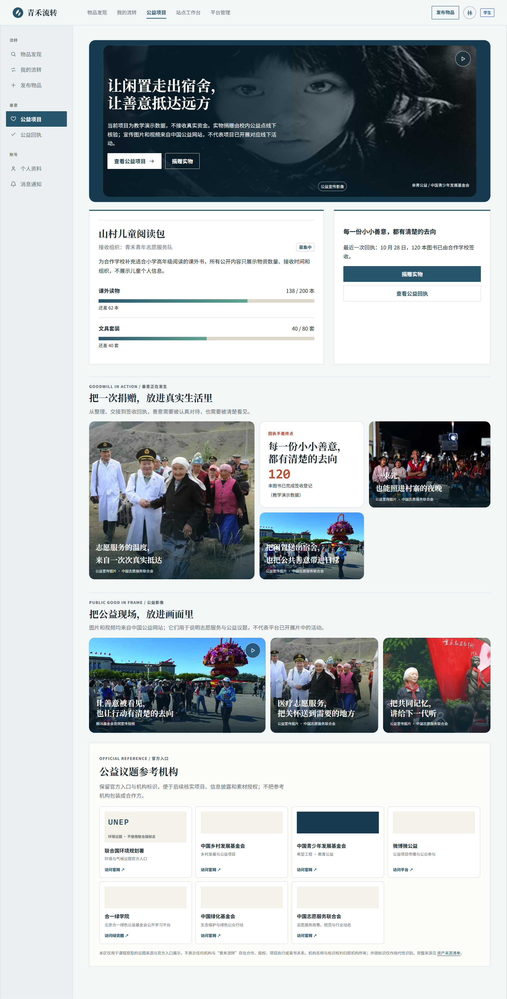

公益页的图文区使用中国乡村课堂、中国小学课堂、淮安图书馆与旧书场景；主视觉使用不出现外文标牌的物资整理视频。项目按课程归档保留这些媒体，并在作者、来源、许可和“场景示意”边界允许的范围内声明；涉及未成年人的素材不代表真实项目成果或相关机构背书，复刻或再次分发时应自行核对原来源权利。该处理借鉴公益网站“让结果被看见”的表达方式，但不借用外部站点的品牌、页面构图或文案。

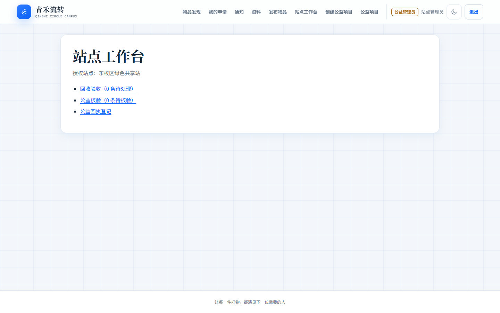

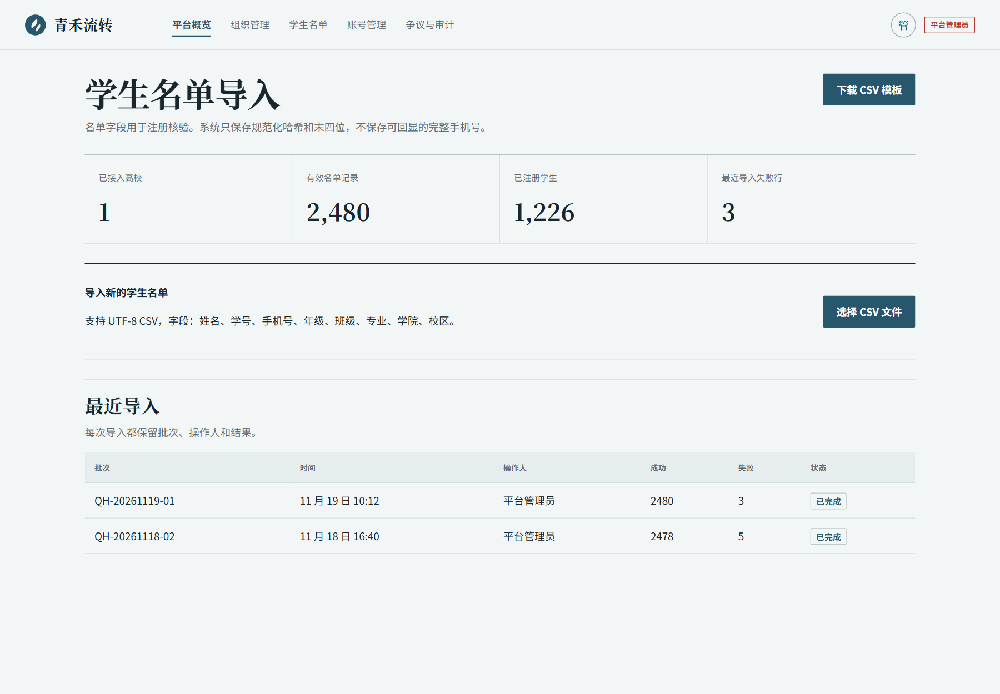

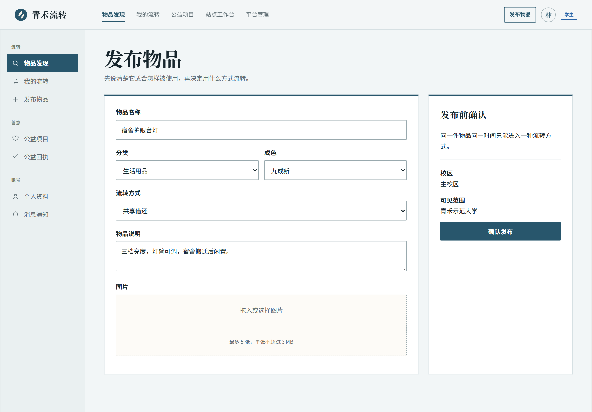

## 8. 响应式规则

- 1080 px 以上采用完整左导航和双栏详情。
- 901–1079 px 收窄侧栏，筛选保留。
- 900 px 以下隐藏左导航，保留顶部品牌栏并显示底部三项主导航。
- 601–900 px 物品卡使用两列，600 px 以下改为单列；主操作留在内容流中，避免遮挡。
- 表格在独立容器内提供局部横向滚动，不撑开整页。
- 交接码、金额、数量等关键数字不得小于 16 px。

## 9. 状态与反馈

- 加载：使用页面骨架，不使用无限旋转。
- 成功：显示结果和下一步入口。
- 失败：说明原因、保留输入、提供重试。
- 空态：说明为什么为空，并给一个下一步。
- 删除式风险：使用文字确认“停用/下架”，同时说明历史记录保留。
- 倒计时：交接码和验证码显示剩余时间，过期后按钮变为重新生成。

## 10. UI 六维评审

| 维度 | 本设计的选择 | 代价与控制 |
|---|---|---|
| 整体气质 | 清爽、真实、有人情味 | 东亚人物与中国校园场景承担情绪，物品实拍承担识别 |
| 密度 | 发现页中密度，详情页低密度，管理台高密度 | 不同角色页面不强行套同一卡数 |
| 骨架 | 学生端左导航 + 主内容；发现页四类流转采用多选项卡片 | 移动端改底部导航，物品卡降为单列 |
| 导航深度 | 核心操作不超过三级；发布与交接直达 | 我的物品和申请使用统一状态筛选，不增加深层菜单 |
| 反馈与动效 | 页面淡入、首屏分段显现、卡片交错进入与悬停反馈、进度生长、两处可暂停视频；动效只解释层级、状态和空间 | 支持 reduced motion；视频降级为海报；布局不依赖动画结束 |
| 状态与时间 | 时间线 + 状态标签 + 到期倒计时 | 颜色之外同时使用中文状态和时间文本 |

## 11. 可访问性

- 正文与背景对比度达到 WCAG AA。
- 所有图标按钮有可读文本或 `aria-label`。
- 表单错误与字段通过 `aria-describedby` 关联。
- 键盘可完成登录、筛选、申请、交接码输入和管理操作。
- 页面不依赖颜色唯一表达状态。
- 图片有替代文本；纯装饰图形从辅助技术隐藏。

## 12. 原型运行

直接打开 `prototype/index.html`。可用查询参数查看指定页面：

```text
?view=discover&variant=A
?view=role
?view=context&role=student&school=4151010610
?view=admin
?view=login&role=student&school=4151010610&campus=WANGJIANG
```

原型只是设计评审材料，不连接数据库，不构成 6.3 的实现代码。

<!-- docx-page-break -->

## 13. 变更记录

| 版本 | 日期 | 变更 |
|---|---|---|
| 1.0 | 2026-11-19 | 建立品牌、页面骨架、视觉方向、页面清单和交互原型 |
| 1.1 | 2026-11-19 | 明确学生学校选择页保留城市、本科/专科标签并隐藏办学性质 |
| 1.2 | 2026-11-19 | 学校选择改为输入即搜索的一体化下拉，明确平台管理员只预置 1 个 |
| 1.3 | 2026-11-19 | 建立“青禾档案”视觉系统，重做发现、身份、详情、后台和移动端导航 |
| 1.4 | 2026-11-20 | 按真实校园照片和成熟网站参考重构发现页，恢复多选项与渐变圆斑，身份选择改为下拉框，并加入克制动效 |
| 1.5 | 2026-11-20 | 增加 15 个以上有效站点调研；公益页加入可暂停场景视频、授权图片标语和回执图集；发现页增加编辑式二次流转图文区；补齐页面切换、滚动显现、进度和减少动效规则 |
| 1.6 | 2026-11-20 | 将人物与公益场景替换为东亚、中国大陆素材；加入中国校园与公益物资两段本地视频；物品卡与列表缩略图全部使用真实物品照片；补充物品卡交错显现、悬停反馈和视频无障碍检查 |
| 1.7 | 2026-11-20 | 五所高校校徽按图形边界裁边并居中，填满 44×44 px 圆形控件；新增五校徽章渲染检查 |
| 1.8 | 2026-11-21 | 统一工作区与登录页校园蓝白视觉，加入浅色/深色主题；身份选择改为登录页右上角面板；修正桌面登录页纵向溢出（D-044） |
| 1.9 | 2026-11-21 | 按参考图校准鲜亮蓝色体系，恢复登录主视觉下方的蓝色双环（D-045） |
| 2.0 | 2026-11-21 | 官方入口未选身份直接提示；身份单选原地更新；桌面登录页消除页面滚动条（D-046） |
| 2.1 | 2026-11-21 | 身份单选实时同步会话，修复学生校区和注册入口的身份冲突（D-047） |
| 2.2 | 2026-11-21 | 学校与校区选择页改为校园坐标网络双栏布局，新增原创校园路径动画（D-048） |
| 2.3 | 2026-11-21 | 注册页改为身份核验双栏动画；学校校区页左侧移除步骤式文案（D-049） |
| 2.4 | 2026-11-21 | 增加学生注册前的学校校区选择防呆提示（D-050） |
| 2.5 | 2026-11-21 | 学校搜索改为单字、连续关键字实时结果列表（D-051） |
